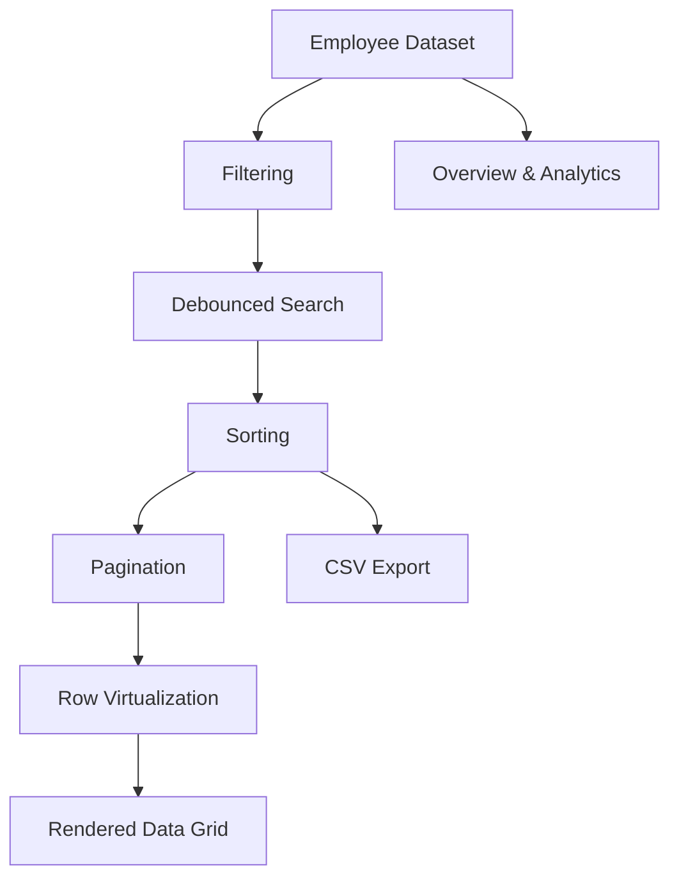

# GridForge — High-Performance Data Grid


**GridForge** is a high-performance employee data management workspace built with React and TypeScript. It combines row virtualization, pagination, search, sorting, filtering, CSV export, and workforce analytics to deliver a responsive experience with datasets of up to **100,000 employees**.

🔗 **Live Demo:** [gridforge-rudra.vercel.app](https://gridforge-rudra.vercel.app)  
💻 **Source Code:** [GitHub Repository](https://github.com/rudra2004-dev/gridforge)

---

## Overview

Rendering thousands of records directly in the DOM can make a data-heavy application slow and difficult to navigate.

GridForge addresses this challenge with a virtualized data grid and a structured data-processing pipeline. Instead of rendering every employee row simultaneously, it renders only the rows needed for the current viewport.

The result is a workspace designed around performance, usability, and maintainable frontend architecture.

## Features

### ⚡ High-Performance Data Grid

- **Row virtualization** using TanStack Virtual to limit the number of rendered DOM elements.
- Supports configurable datasets of 1,000, 10,000, and 100,000 employees.
- Sticky column headers and aligned columns using CSS Grid.
- Comfortable and compact row-density options.
- Responsive workspace layout with a collapsible sidebar.

### 🔎 Search, Sort & Filter

- Debounced search with a 250 ms delay.
- Multi-word search across employee ID, name, email, role, department, and status.
- Tri-state sorting: ascending, descending, and disabled.
- Natural sorting for identifiers such as `EMP2` and `EMP10`.
- Combined department and employee-status filters.
- Pagination with configurable page sizes of 25, 50, 100, and 250 rows.

### 📊 Workforce Analytics

- Overview dashboard with key workforce metrics.
- Employee headcount by department.
- Employee-status distribution.
- Recent hires overview.
- Payroll, median salary, average tenure, and inactive-rate metrics.
- Department analytics with headcount, average salary, and payroll views.
- Hiring trends and salary distribution.

### 📁 Data Management

- Export all matching employees to CSV, not just the current page.
- CSV escaping compliant with RFC 4180.
- Spreadsheet formula-injection mitigation for exported text fields.
- UTF-8 BOM for improved Excel compatibility.
- Add-employee dialog with input validation.
- Validation for required fields, email format and uniqueness, salary, and dates.

### ⚙️ Workspace Settings

- Configurable dataset size.
- Adjustable row density.
- Persistent preferences using `localStorage`.
- Validation of stored settings with fallback defaults.
- Client-side routing with active navigation states, a 404 page, and scroll restoration.

## Tech Stack

| Technology | Purpose |
|---|---|
| React 19 | Component-based user interface |
| TypeScript | Type safety and maintainability |
| Vite | Development server and production builds |
| TanStack Virtual | Efficient row virtualization |
| Zustand | Centralized application state |
| React Router 7 | Client-side routing |
| Lucide React | Icons |
| CSS | Responsive layouts, data-grid styling, and charts |
| Vitest | Unit testing, where configured |

## Architecture

GridForge separates source data, transformation logic, rendering, and workspace presentation.



Each transformation is designed to operate independently, making the data-processing pipeline easier to understand, test, and maintain.

### Virtualization Strategy

GridForge uses TanStack Virtual to calculate which rows should be visible inside the scroll container.

- A spacer represents the total scrollable height of the dataset.
- Only visible rows and a small overscan buffer are rendered.
- Rows are positioned using transforms to maintain their correct positions.
- A shared CSS Grid column template keeps headers and rows aligned.

This approach reduces DOM overhead when working with large datasets.

### State Management

Zustand manages employee data, search queries, sorting, and filters. Workspace preferences are persisted separately in `localStorage`.

Derived data is computed from the source state rather than duplicated in the store, helping prevent inconsistent results.

## Performance

GridForge is designed to handle datasets containing up to 100,000 employee records.

The key performance strategy is to render only the rows required for the current viewport rather than mounting every row simultaneously.

**Benchmark results:** Quantitative comparisons against a non-virtualized implementation should be added after measuring DOM node counts, render time, and scroll performance under the same test conditions.

## Getting Started

### Prerequisites

- Node.js 20.19 or newer recommended.
- npm.
- Git.

### Installation

```bash
# Clone the repository
git clone https://github.com/rudra2004-dev/gridforge.git

# Enter the project directory
cd gridforge

# Install dependencies
npm install

# Start the development server
npm run dev
```

Open the local URL printed in your terminal to explore the application.

### Available Scripts

| Command | Description |
|---|---|
| `npm run dev` | Start the development server |
| `npm run build` | Type-check and build for production |
| `npm run preview` | Preview the production build |
| `npm run lint` | Run ESLint |
| `npm test` | Run unit tests, if the test script is configured |

## Project Structure

```text
src/
├── components/
│   ├── charts/          # CSS-based charts
│   ├── grid/            # Data grid, virtualization, pagination
│   └── layout/          # Header, sidebar, page container
├── features/
│   ├── employees/       # Employee data, state, search, sorting,
│   │                    # filtering, CSV export, analytics
│   └── settings/        # Persisted workspace preferences
├── hooks/               # Debouncing and pagination hooks
├── lib/                 # Shared routing utilities
├── pages/               # Overview, employees, analytics, settings
├── App.tsx
├── router.tsx
└── main.tsx
```

## Engineering Challenges & Design Decisions

### 1. Keeping Columns Aligned During Virtualization

Traditional table layout can cause column widths to shift when rows are dynamically mounted and unmounted.

**Solution:** Use CSS Grid with a shared column template for the header and body rows.

### 2. Efficient Data Processing

Repeatedly processing the same dataset for every UI update can introduce unnecessary work.

**Solution:** Separate filtering, searching, sorting, and pagination into memoized transformation stages.

### 3. Safe CSV Export

Spreadsheet applications may interpret user-controlled cell values beginning with formula characters as executable formulas.

**Solution:** Escape CSV fields, neutralize potentially dangerous text prefixes, and preserve compatibility with spreadsheet applications.

### 4. Reliable Client-Side Preferences

Persisted browser storage should not be assumed to contain valid values.

**Solution:** Validate settings when loading them and fall back to safe defaults when necessary.

### 5. Deterministic Large Datasets

Randomly generated data makes debugging, screenshots, and performance comparisons harder to reproduce.

**Solution:** Use a seeded employee generator to produce consistent datasets.

## Known Limitations

- Employee records added through the form are currently held in memory and reset after a page refresh.
- Search, sorting, and filtering run on the main thread; sorting large datasets may cause brief pauses.
- Employee data is generated locally rather than retrieved from a production backend.
- The data grid does not yet provide full spreadsheet-style arrow-key navigation between cells.

## Future Improvements

- Persist employee changes using a backend API and database.
- Move expensive data-processing operations into a Web Worker.
- Add server-side filtering, sorting, and pagination.
- Implement column resizing and column visibility controls.
- Add row selection and bulk operations.
- Synchronize search and filter state with URL parameters.
- Improve keyboard navigation and accessibility for grid interactions.
- Add repeatable performance benchmarks and automated regression tests.

## Contributing

Suggestions, bug reports, and improvements are welcome.

1. Fork the repository.
2. Create a feature branch.
3. Make your changes and run the relevant checks.
4. Open a pull request with a clear description of the changes.

## Author

**Rudra Prosad Ghosh**

- GitHub: [@rudra2004-dev](https://github.com/rudra2004-dev)

Built to explore high-performance React rendering, scalable client-side data processing, state management, and production-minded frontend engineering.
