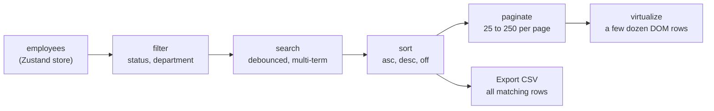

<!--
  BEFORE PUBLISHING, search this file for "TODO" and fill in:
  1. Live demo URL
  2. Screenshots and demo GIF in docs/
  3. Benchmark numbers (measure them yourself, see "How I measured")
  4. Delete the Testing section if you haven't added Vitest tests
  Then delete this comment.
-->

# GridForge


An employee data grid built with React and TypeScript that stays smooth at **100,000 rows**. It combines row virtualization, pagination, and memoized client-side search, sort and filter, with a workspace around it: an overview dashboard, analytics, and persistent settings.

**[Live demo](https://gridforge-rudra.vercel.app)** · [Report an issue](https://github.com/rudra2004-dev/gridforge/issues)

<!-- TODO: add docs/demo.gif (scrolling, searching, sorting, switching to 100,000 rows) -->


## Highlights

- **Virtualized grid:** only a few dozen row elements exist in the DOM at any time, whether the dataset has 1,000 or 100,000 employees.
- **One pipeline, pure functions:** `filter → search → sort → paginate → virtualize`, each stage a memoized step over plain functions.
- **Real product details:** debounced multi-term search, tri-state sorting, CSV export with injection protection, accessible add-employee dialog with validation, settings that survive a refresh.
- **Built from scratch:** no UI kit, no grid library, no chart library.

## Screenshots

<!-- TODO: add these three images to docs/screenshots/ -->

| Data grid | Overview | Analytics |
|---|---|---|
|  |  |  |

## Features

### Data grid
- Virtualized rows with a sticky header and a CSS Grid column template shared by header and rows, so columns stay aligned while scrolling
- **Search:** debounced (250 ms), multi-word AND matching across ID, name, email, role, department and status
- **Sort:** click a header to cycle ascending, descending, off. Natural ordering (`EMP2` before `EMP10`)
- **Filter:** status and department, combined with search and sort
- **Pagination:** 25, 50, 100 or 250 rows per page with a stable seven-slot page control. Changing search, filters, sort or page size returns to page 1
- **Export CSV:** exports every matching row (not just the current page), RFC 4180 escaping, spreadsheet-formula neutralization, UTF-8 BOM for Excel, date-stamped filename
- **Add employee:** native `<dialog>` form with validation (required fields, email format and uniqueness, salary and date checks, normalized input)

### Workspace
- **Overview:** KPIs, headcount by department, status breakdown and recent hires. Chart rows link into the grid with the filter already applied
- **Analytics:** payroll, median salary, average tenure and inactive rate; department chart switchable between headcount, average salary and payroll; hires per year; salary distribution
- **Settings:** dataset size (1,000 / 10,000 / 100,000), row density (comfortable 56 px or compact 40 px), reset data. Saved to `localStorage` and validated on load
- **Routing:** layout route with `<Outlet />`, `NavLink` active states, per-route header greeting via route `handle`, 404 page, scroll restoration
- Collapsible sidebar and a responsive layout

## Performance

Benchmark: 10,000 employees in a single list (pagination bypassed), same row markup, Chrome, 4x CPU slowdown for the FPS test.

<!-- TODO: replace every TODO below with numbers you measured -->

| Metric | Naive render (all rows) | Virtualized |
|---|---|---|
| Row elements in the DOM | TODO | TODO |
| DOM nodes (Performance monitor) | TODO | TODO |
| Time to render the list | TODO | TODO |
| Scroll FPS (4x CPU slowdown) | TODO | TODO |

At 100,000 rows the virtualized grid renders TODO row elements.

<details>
<summary>How I measured</summary>

1. Settings → **10,000** employees.
2. In `DataGrid.tsx`, temporarily pass `visibleEmployees` instead of `pageItems` to `VirtualizedRows`, so the list isn't paginated.
3. **Row elements:** run `document.querySelectorAll(".vgrid-body-row").length` in the console.
4. **DOM nodes:** DevTools → Performance monitor → DOM Nodes.
5. **Render time:** Performance panel, record a page reload, and note the time until the grid is painted.
6. **Scroll FPS:** set CPU to 4x slowdown, record 5 seconds of continuous scrolling, and read the frame rate from the Frames row.
7. **Naive baseline:** temporarily replace the virtualizer with `employees.map(...)` rendering the same row markup, then repeat steps 3 to 6.
8. Revert both temporary changes.

</details>

## How it works

### Virtualization

The scroll container has a bounded height (`max-height` plus `overflow: auto`). Inside it, a spacer element is `count × rowHeight` tall, so the scrollbar represents the whole list. [TanStack Virtual](https://tanstack.com/virtual) reports which rows intersect the viewport (plus an overscan buffer of 10), and only those are rendered, each absolutely positioned with `transform: translateY(...)`.

### Data pipeline



Each stage is a pure function in its own `useMemo`, so changing the sort doesn't redo the search, and typing in the search box doesn't redo the filter. Stages return their input array unchanged when idle, so with nothing active the pipeline allocates nothing new.

### State

| Store | Holds | Persisted |
|---|---|---|
| `employee.store` | employees, search query, sort, filters | No (regenerated from a fixed seed) |
| `settings.store` | dataset size, row density | Yes, `localStorage` with validation on load |

Derived data (filtered lists, aggregates, the current page) is **computed, never stored**, so it can't drift out of sync with its source.

## Key decisions

| Decision | Why |
|---|---|
| Headless virtualizer (TanStack Virtual) | Full control over markup and styling, works with CSS Grid |
| Div and CSS Grid instead of `<table>` | A table sizes columns from the rows currently rendered, which changes as virtualization swaps rows. One shared `grid-template-columns` keeps header and rows aligned |
| Pure functions for filter, search, sort, export, validation, analytics | No React inside, so they are trivial to unit test and reuse |
| Zustand with selectors | One source of truth without boilerplate; components re-render only for the slice they read |
| Seeded generator (mulberry32) | Same data on every load: reproducible demos, screenshots and benchmarks |
| Native `<dialog>` | Focus trapping, Esc to close, inert background and backdrop without a library |
| Hand-built charts | Two simple chart shapes don't justify a charting dependency; keeps markup accessible |
| Raw numbers in CSV exports | A formatted `$80,000` contains a comma and isn't numeric in Excel |

## Challenges and what I learned

- **Columns drifting out of alignment.** My first version used a `<table>` with automatic layout. The browser sized columns from whichever rows were rendered, so widths shifted as virtualization swapped rows, and the header disagreed with the body. I moved to CSS Grid with one column template shared by the header and every row, and placed the sticky header inside the same scroll container so the scrollbar affects both equally.
- **Resetting to page 1 without an effect.** Instead of syncing state in a `useEffect`, the pagination hook stores the requested page together with a key describing the current view (query, filters, sort, page size). If the key changes, the stored page is ignored and page 1 is derived, with no extra render and no stale state.
- **CSV safety.** Employee names are user data, and a cell like `=HYPERLINK(...)` runs as a formula in Excel. Text cells starting with `=`, `+`, `-` or `@` are prefixed so they stay text, and fields containing commas, quotes or newlines are quoted per RFC 4180.
- **Not trusting `localStorage`.** Persisted settings are validated on load and fall back to defaults, so a hand-edited `datasetSize` can't freeze the page.
- **Generating 100,000 unique emails.** Looping until a free address was found became quadratic when 900 name combinations repeat. A per-name counter makes it O(1) and produces identical output.

## Tech stack

React 19 · TypeScript · Vite · Zustand · TanStack Virtual · React Router 7 · lucide-react · ESLint

## Getting started

Requires a recent Node.js LTS (20.19 or newer recommended).

```bash
git clone https://github.com/rudra2004-dev/gridforge.git
cd gridforge
npm install
npm run dev
```

| Script | What it does |
|---|---|
| `npm run dev` | Start the dev server |
| `npm run build` | Type-check and build for production |
| `npm run preview` | Serve the production build locally |
| `npm run lint` | Run ESLint |
| `npm test` | Run unit tests (Vitest) |

## Project structure

```
src/
├── components/
│   ├── charts/          BarChart, ColumnChart (CSS-based)
│   ├── grid/            DataGrid, VirtualizedRows, Pagination, pagination.utils
│   └── layout/          Header, PageContainer, Sidebar
├── features/
│   ├── employees/       store, types, generator, search, sort, filter,
│   │                    export, validation, overview, analytics,
│   │                    AddEmployeeDialog, EmployeePageHeader
│   └── settings/        settings.store (persisted preferences)
├── hooks/               useDebounce, usePagination
├── lib/                 routeHandle (typed route metadata)
├── pages/               Overview, Employees, Analytics, Settings, NotFound
├── App.tsx              layout route
├── router.tsx           route table
└── main.tsx             entry
```

## Accessibility

- Every control is a real `<button>`, `<select>` or `<a>`, with visible focus styles
- Sortable headers expose `aria-sort`; the current page and active nav item use `aria-current`
- The footer range text is `aria-live="polite"`, so result counts are announced
- The add-employee dialog uses native modal behavior (focus trap, Esc, focus restore); form errors are tied to their inputs with `aria-invalid` and `aria-describedby`, and focus moves to the first invalid field
- Charts expose their values as text (a list for bars, an `aria-label` summary for columns), and animations respect `prefers-reduced-motion`

The grid is not a full ARIA grid widget: there is no arrow-key navigation between cells.

<!-- TODO: delete this Testing section if you haven't added Vitest tests -->
## Testing

Unit tests cover the pure logic: CSV escaping and filenames, form validation, page-window calculation, overview and analytics aggregation, and the seeded generator.

```bash
npm test
```

## Deployment

Static build, deployable anywhere. Because routing is client-side, the host must serve `index.html` for unknown paths, otherwise refreshing on `/employees` returns a 404.

- **Vercel:** import the repo (framework preset: Vite) and add `vercel.json`:
  ```json
  { "rewrites": [{ "source": "/(.*)", "destination": "/index.html" }] }
  ```
- **Netlify:** build command `npm run build`, publish directory `dist`, and add `public/_redirects` containing `/* /index.html 200`

## Known limitations and next steps

- Employees added through the form are kept in memory only and reset on refresh. Next: persist user-added rows.
- Search, sort and filter run on the main thread. At 100,000 rows, sorting a text column pauses briefly. Next: move the pipeline into a Web Worker, or sort on a server.
- Data is generated locally. Next: a mock API with infinite loading (TanStack Query) to exercise server-side pagination.
- Next: column resizing and visibility, row selection with bulk actions, URL-synced filters so views are shareable, and arrow-key cell navigation.

## Author

Built by Rudra Prosad Ghosh.